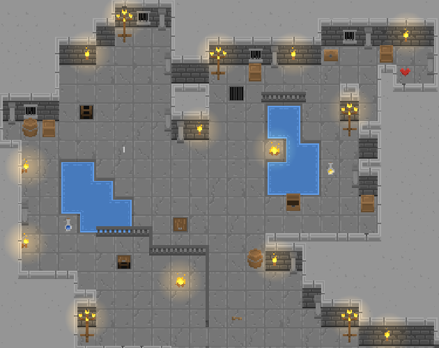

# Dragon Hood: Art Direction

## Purpose
Guide new and revised art toward a consistent camera, pixel size, and palette. Improve consistency over time; exact proportions are secondary to readability on a small screen.

## Scope
World art, characters, enemies, and environmental effects. The supplied dungeon image is the visual reference for pixel treatment, three-quarter perspective, and restrained surface detail, not a requirement to make every area a dungeon.

## World and mood
A bleak, dangerous post-apocalyptic fantasy world becomes cozy, bright, and welcoming under the player's influence. Steampunk machinery provides occasional accents, with richer concentrations in selected areas.

Unrestored places use weathered materials, subdued colour, and signs of neglect. Restored places look brighter and cleaner while retaining their material identity. Make the change readable at normal play scale. Additional repairs, greenery, or machinery changes depend on the site's design.

## Camera and scale
- The viewport uses a top-down square grid. Artwork starts overhead, tilted roughly 45 degrees toward a south camera: show crowns, backs and top surfaces with compressed front faces. This deliberately mixes perspectives rather than using a physically correct projection. Raised walls and traps retain enough upright height to show their faces.
- Raised surfaces reveal a front-facing wall or cliff below their top plane: a clear lip, shaded face, and grounded base. Tilled plots read as shallow depressions; shrine footings rise above their surroundings. Roads retain their softly blended edges without depression walls. Keep landscape terrain level for now.
- Keep the square map axes aligned with the screen. This is not an isometric diamond grid.
- Building sprites use a three-quarter top-down camera too: show substantial roof depth and tower tops, with shorter, foreshortened front walls. Keep entrances facing screen-bottom; avoid a face-on architectural elevation.
- Author new house sprites within 64×64 pixels and forts within 80×80 pixels. Use broad shapes, restrained trim and a single readable gambling emblem on the fort. Review exports at their actual pixel size; shrinking a detailed illustration does not make its detail appropriate for this resolution.
- Keep house and fort masses approximately balanced around upright world Z: compact footprints, centred roof crowns, balanced wings or towers. Doors and small role details can break symmetry. The viewing direction is about 45 degrees from Z, not aligned with it; retain the tilted top-down view and cardinal footprint alignment. Avoid large directional annexes and steep front-facing roofs that become jarring during compass rotation.
- Everything except roads, buildings, and game characters lives on a 24px tile grid, scaled to the device for a crisp pixel look. Larger tiled objects can span multiple cells.
- Match apparent pixel size across assets. Use crisp scaling for raster art; avoid mixing tiny detailed pixels with enlarged coarse pixels in neighbouring objects.
- The 24px grid is the art target. Source sprites may be 16px or 24px; the current runtime display cell is 32px (`src/sprite_layout.js` and `src/app.js`). These are separate sizes; assess assets together at their final display scale.
- Characters and enemies have chunky proportions and move continuously, including between cells, to accommodate GPS movement. The art grid does not constrain movement.

## Player concealment and story illustrations

- Story/event illustrations intentionally use a different visual style from the main game world. The illustration references and rules in this section govern dialog paintings, not map sprites, terrain, buildings or other in-world assets. Do not try to make the two styles converge: retain the world-art camera, scale and material rules above for gameplay assets, and the approved narrative illustration treatment for story panels.

- For every new or regenerated story panel, supply an approved existing story painting that shows the Hood as an explicit image reference, alongside any scene-specific reference. Match its character proportions, concealed brown hood, palette and painting treatment; a text-only style description is not enough. Record the selected reference with the prompt.

- Never show the player's face or hair. Keep the brown hood raised and the face fully hidden by opaque shadow or a rear view, including in profile and torchlight. No visible eyes, facial skin or glowing eyes.
- Story and event illustrations target a 4:3 landscape image area, with dialog copy and controls in a separate content area below. Fill the artwork with the scene; never reserve a blank, dark or faded text zone inside it. Preserve the original formats of the first two opening panels (compass discovery and nightmare, including both animation frames of each). The book reading background is a separate UI asset. Prefer a deliberate crop of existing artwork when it preserves the subject and removes the old copy zone; regenerate when framing or style cannot be fixed by cropping.
- Approved story style references are `assets/art/cave_first.webp` and `assets/art/npc_orrin.webp`: match their deliberate pixel clusters, earthy palette and character treatment, not their tall format or embedded text zones. Use the cave painting for Hood's concealed appearance. Story illustrations use grounded, natural figure proportions without oversized chibi heads.
- Hood must read as an adult of ordinary height beside other adults and furniture: avoid a large hood/head, compressed torso or short legs that make the player look child-sized. Keep time of day ambiguous in general, using diffuse subdued light with at most a subtle dawn/dusk tint. Avoid conspicuous orange sunsets, visible sun discs and strong time-specific shadows unless the story explicitly requires them; local lantern, fire and magical light can still provide warmth.
- Use `cave_first.webp` as Hood's canonical appearance reference, not only a style sample: preserve the brown hood and clothing, backpack, belt, boots, concealed face and consistent outfit silhouette across scenes. Keep the short outer garment and visible trousered legs rather than substituting a floor-length robe. Use `npc_orrin.webp` for the broader pixel treatment and palette. A scene-specific source with a different outfit must not override the approved Hood reference.
- For outdoor story scenes, also supply the original `assets/art/restore_house.webp` as the sky, landscape and palette reference. Preserve its rich ochres, warm earth colours, olive foliage and luminous warmth. Ambiguous time of day does not mean gray weather, cold light or desaturation: retain warm colour while softening explicit sunset cues. The original palette is preferred over the cooler restored-home sample from the second 4:3 review. Use each reference for its stated role; the outdoor reference does not override Hood's appearance or reintroduce a text zone.
- Use the original `assets/art/street_bandit.webp` (roadside wagon) as the reference for a restricted palette and deliberate pixel construction. Prefer fewer distinct colours, clear pixel clusters, stepped shading and simple readable forms. Do not replace that treatment with richly shaded digital painting, fine texture noise, smooth gradients or a high-detail image with a pixel filter. Preserve these qualities when cropping or remaking an existing painting; additional detail is not an improvement by itself.

## Spritesheet generation
- Generate spritesheets as an 8 × 8 grid of sprites: eight columns and eight rows, for 64 frames. Design each frame in a 24 × 24 px pixel-art style, with deliberate pixel clusters, crisp edges and restrained detail.
- A sheet of single-cell sprites is 192 × 192 px at the target resolution. Higher-resolution generations are enlarged working images; they must not introduce finer detail than the 24 × 24 px style can support. Review the extracted frames at their final game scale.
- Keep frame spacing, ground anchors and apparent pixel size consistent across the sheet. Use transparent backgrounds and keep artwork inside its assigned frame. Declare larger, multi-cell objects separately rather than squeezing them into a single-cell silhouette.
- The 8 × 8 layout is the generation convention, not a requirement to repack existing runtime sheets. Preserve the scale exceptions above for buildings, roads and characters; buildings still follow the three-quarter top-down camera rule.

## Colour, vectors, and light
- Use a shared, restrained palette across terrain, props, buildings, and actors. Coordinate material colours and shadow tones; reserve stronger colour and contrast for useful focal points and restoration.
- Vector art supports real-world road and building geometry. Smoother edges are acceptable; match the surrounding art's perspective, palette, and visual weight. A pixel-treated vector comparison is a future experiment.
- Preserve the strong existing lighting. Warm local lights help objects read against subdued surroundings; lighting supports the palette rather than hiding mismatched assets.

## Review at game scale
Check each addition beside existing art on a small screen: consistent camera, comparable pixel size, compatible colours, clear silhouette, and a legible unrestored/restored difference where applicable.
